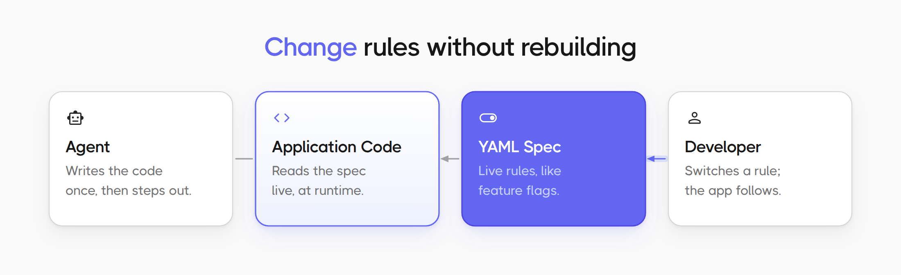
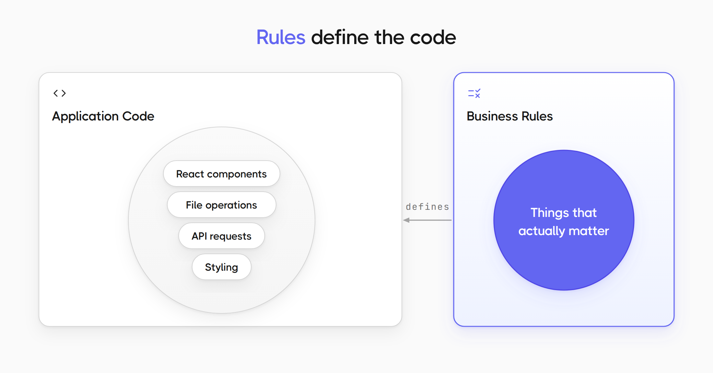

# scripted-yaml

**YAML with a little sugar for formulas, conditions, and scripts.**

Let an agent write 99% of your application. Keep the important 1% under your direct control.

<p align="center">
  
</p>

- **Some code is too important to leave buried in generated implementation.** Pricing rules,
  RPG formulas, UI structure, and business processes determine what your application does.
  You need to read, understand, and change them when needed.
- **You control YAML specs; agents execute them.** YAML specs are executable application
  definitions, not outdated specs or documentation to reimplement.
- **Self-contained YAML, with scripting sugar.** Keep inputs, data, formulas, conditions,
  together for easy editing.
- **Declare state machines, UIs, and business processes in YAML.** Describe states, transitions,
  screens, and workflow steps as data and rules; application code interprets the definitions.
- **Each YAML spec can choose its own DSL.** UI, business logic, validation rules, and access control can use
  different Domain Specific Languages in one project.
- **Structure checking—like TypeScript for YAML.** A defined DSL checks required fields,
  nested shapes, and allowed values.
- **Use the included [agent skill](skills/scripted-yaml-convert/SKILL.md) to migrate existing logic.**
  Ask your agent to extract business rules from application code into YAML specs, preserving
  the existing behavior.

## Application code and business rules

<p align="center">
  
</p>

**Application code** is fully written by agent, takes some decisions implicilty, without asking you, writing them into code.
**Business rules** expose implemented decisions for better underestanding and for further change.

### Why YAML?

We selected YAML because it is readable and compact (no curly braces, no types). We added small things on top:

- Expression language - to set variables dynamically in flexible way
- Vars as `$vars` key - to declare set of required variables
- Schema `$schema` (inline) or usef in multiple files via `$dsl`
- Functions obtained from application or declared internally

### Example: a nav bar by plan

**1. Rules buried in JSX.** Which plans see Reports? You'd have to ask an agent and trust its guess.

```jsx
export function NavBar({ plan }) {
  return (
    <nav>
      <Link to="/">Dashboard</Link>
      {plan !== 'free' && <Link to="/reports">Reports</Link>}
      {plan === 'team' && <Link to="/team">Team</Link>}
      {plan === 'free' && <Link to="/pricing">Upgrade</Link>}
    </nav>
  );
}
```

`plan !== 'free'` quietly gives Reports to any new plan, and the same checks spread to sidebars and route guards.

**2. Move the rules to YAML.** One file you own; `$if!` drops an item when false.

```yaml
# navbar.yml
$vars:
  plan: { default: free }

navbar:
  - label: Dashboard
    path: /
  - label: Reports
    path: /reports
    $if!: vars.plan in ["pro", "team"]
  - label: Team
    path: /team
    $if!: vars.plan = "team"
  - label: Upgrade
    path: /pricing
    $if!: vars.plan = "free"
```

**3. React only renders.** No plan checks left; the agent can keep working on this part.

```jsx
import { ScriptedYaml } from 'scripted-yaml/core';
import navbarYaml from './navbar.yml?raw'; // Vite text import

const navbar = new ScriptedYaml().loadTextSync(navbarYaml, { file: 'navbar.yml' });

export function NavBar({ plan }) {
  const { navbar: items } = navbar.resolve({ vars: { plan } });
  return (
    <nav>
      {items.map((item) => (
        <Link key={item.path} to={item.path}>{item.label}</Link>
      ))}
    </nav>
  );
}
```

For `pro` this renders Dashboard and Reports.

**4. Change a rule in one line.** Give Team to `pro`, no component change:

```diff
   - label: Team
     path: /team
-    $if!: vars.plan = "team"
+    $if!: vars.plan in ["pro", "team"]
```

## Small examples

### A UI definition

- Edit `title` or move a field between groups directly in YAML.
- The UI code renders this structure; it does not own another copy of the layout.

```yaml
title: Edit profile
groups:
  - title: Personal details
    fields: [name, email]
  - title: Preferences
    fields: [language, timezone]
```

### An RPG character

- Change `hp_per_level` to rebalance the character.
- `hit_points!` is a formula: at level 7, this character has 84 hit points.

```yaml
name: Brom
level: 7
hp_per_level: 12
hit_points!: level * hp_per_level
```

### A discount rule

- Change the threshold or formula in one place.
- At a subtotal of 240, the discount is 24 and the message is `You save 24.`

```yaml
$vars:
  subtotal: {}

discount!: if vars.subtotal >= 200 then vars.subtotal * 0.10 else 0
message: You save {{ discount }}.
```

## Install

```sh
npm install scripted-yaml
```

Node 22+ or Bun. Importing `.ts` files requires Bun or Node 22.18+.

**Load only trusted files:** loading runs `$import` modules and marker handlers.
Validation runs neither and evaluates no formulas.

## Complete examples

Complete files: [`examples/`](examples).

### Shop: discounts and shipping

Change the loyalty rate or free-shipping threshold here; the checkout implementation consumes these rules.

```yaml
$vars:
  cart:     { about: The order. Its subtotal is used here. }
  customer: { about: The buyer. Past orders and tags. }

is_vip!: count(vars.customer.orders) >= 10 or "vip" in vars.customer.tags

discount:
  loyalty!: if is_vip then vars.cart.subtotal * 0.05 else 0
  volume!: if vars.cart.subtotal >= 200 then 15 else 0
  $value!: max(loyalty, volume)
  note: The bigger of the two discounts applies.

to_pay!: vars.cart.subtotal - discount

shipping:
  - name: Standard
    price!: if to_pay >= 50 then 0 else 4.90
  - name: Express
    price: 12.90
    $if!: is_vip

message: You pay {{ to_pay }} and save {{ discount }}.
```

With `cart: { subtotal: 240 }` and a customer tagged `vip`:

```js
{
  is_vip: true,
  discount: { loyalty: 12, volume: 15, $value: 15, note: 'The bigger of the two discounts applies.' },
  to_pay: 225,
  shipping: [{ name: 'Standard', price: 0 }, { name: 'Express', price: 12.9 }],
  message: 'You pay 225 and save 15.',
}
```

Reading `discount` in a formula returns its `$value` (15); the other fields explain the calculation.

### UI: parts that show, hide and change

Rename labels, reorder the sidebar, or change visibility rules without asking an agent to edit components.
The application supplies the renderer and action handlers.

```yaml
$vars:
  user:  { optional: true, about: The signed-in user. Null when signed out. }
  plan:  { default: free }
  flags: { default: [] }

signed_in!: vars.user != null
is_admin!: if signed_in then vars.user.role = "admin" else false
paid!: vars.plan != "free"

header:
  title: Dashboard
  greeting!: if signed_in then "Welcome back, " + vars.user.name else "Welcome"

sidebar:
  - label: Home
    icon: home
  - label: Reports
    icon: chart
    $if!: paid
  - label: Upgrade
    icon: star
    action!js: openCheckout()
    $unless!: paid
  - label: Admin
    icon: shield
    $if!: is_admin
  - $each!: vars.flags
    $as: flag
    label: Beta {{ flag }}
    icon: flask

theme:
  accent: blue
  $when:
    - $if!: paid
      accent: gold
```

Signed out, on the free plan, the result is:

```js
{
  signed_in: false, is_admin: false, paid: false,
  header: { title: 'Dashboard', greeting: 'Welcome' },
  sidebar: [
    { label: 'Home', icon: 'home' },
    { label: 'Upgrade', icon: 'star', action: Script { js: 'openCheckout()' } },
  ],
  theme: { accent: 'blue' },
}
```

For an admin called Ada on the `team` plan with the flag `charts`, the sidebar is Home, Reports,
Admin and "Beta charts", the greeting is "Welcome back, Ada", and the accent is gold.

`action!js` passes `openCheckout()` to your `js` handler; the library does not execute JavaScript itself.

### Game: an RPG character sheet

Tune progression and skill unlocks here; the game engine applies these definitions.

```yaml
$vars:
  hero: { about: "Name, class, level and the seven base attributes." }
  gear: { default: [], about: "Items worn. Each adds an amount to one stat." }

classes:
  knight:   { hp_per_level: 12, sp_per_level: 0, magic: none }
  archer:   { hp_per_level: 8,  sp_per_level: 2, magic: intellect }
  cleric:   { hp_per_level: 7,  sp_per_level: 5, magic: personality }
  sorcerer: { hp_per_level: 5,  sp_per_level: 6, magic: intellect }

# The row of `classes` for this hero: `get value` looks a key up by a name held in a variable.
hero_class!: get value(classes, vars.hero.class)

$functions:
  from_gear(wanted)!: sum(append(vars.gear[stat = wanted].amount, 0))
  bonus(score)!: floor((score - 10) / 3)

# Base value plus what the gear adds.
attributes:
  might!: vars.hero.might + from_gear("might")
  intellect!: vars.hero.intellect + from_gear("intellect")
  personality!: vars.hero.personality + from_gear("personality")
  endurance!: vars.hero.endurance + from_gear("endurance")
  accuracy!: vars.hero.accuracy + from_gear("accuracy")
  speed!: vars.hero.speed + from_gear("speed")
  luck!: vars.hero.luck + from_gear("luck")

casting!: if hero_class.magic = "personality" then attributes.personality else attributes.intellect

stats:
  hit_points!: (hero_class.hp_per_level + bonus(attributes.endurance)) * vars.hero.level
  spell_points!: if hero_class.magic = "none" then 0 else (hero_class.sp_per_level + bonus(casting)) * vars.hero.level
  armor_class!: from_gear("armor") + bonus(attributes.speed)
  to_hit!: vars.hero.level + bonus(attributes.accuracy)
  damage!: max(1, from_gear("damage") + bonus(attributes.might))

resistances:
  fire!: from_gear("fire") + bonus(attributes.luck)
  water!: from_gear("water") + bonus(attributes.luck)
  mind!: from_gear("mind") + bonus(attributes.personality)

rank!: if vars.hero.level >= 10 then "Veteran" else "Novice"
summary: "{{ vars.hero.name }}, {{ rank }} {{ vars.hero.class }} of level {{ vars.hero.level }}"

skills:
  - name: Strike
    damage!: stats.damage
  - name: Shield Wall
    $if!: vars.hero.class = "knight" and vars.hero.level >= 5
  - name: Aimed Shot
    to_hit!: stats.to_hit + 4
    $if!: vars.hero.class = "archer"
  - name: Heal
    restores!: 5 + bonus(attributes.personality) * 2
    cost: 3
    $if!: vars.hero.class = "cleric"
  - name: Fireball
    damage!: bonus(attributes.intellect) * vars.hero.level
    cost: 8
    $if!: vars.hero.class = "sorcerer" and stats.spell_points >= 8
  - name: Lucky Dodge
    $if!: attributes.luck >= 16
```

For Brom, a level 7 knight (might 18, endurance 16, luck 9) with an iron sword (+4 damage), chain
mail (+6 armor) and a ring of might (+3):

```js
{
  hero_class: { hp_per_level: 12, sp_per_level: 0, magic: 'none' },
  attributes: { might: 21, intellect: 8, personality: 10, endurance: 16, accuracy: 13, speed: 11, luck: 9 },
  casting: 8,
  stats: { hit_points: 98, spell_points: 0, armor_class: 6, to_hit: 8, damage: 7 },
  resistances: { fire: -1, water: -1, mind: 0 },
  rank: 'Novice',
  summary: 'Brom, Novice knight of level 7',
  skills: [{ name: 'Strike', damage: 7 }, { name: 'Shield Wall' }],
}
```

Fields resolve on demand: `stats.hit_points` reads `hero_class` and `attributes.endurance`, regardless of file order.

## Templates

The package carries base files for common jobs. A file builds on one with
`$extends: scripted-yaml/<name>` and writes only its own part; the template brings the schema and
the formulas. `scripted-yaml templates` lists them; each is one readable file in [`templates/`](templates).
[`docs/templates.md`](docs/templates.md) says what each takes and gives, and how to write your own.

| Template | You write | You get |
|---|---|---|
| `scripted-yaml/state-machine` | states, transitions with guards, effects | `allowed`, `next`, `changed`, `final`, `error`, the effects to run |
| `scripted-yaml/navigation-ui` | a menu, with dropdowns up to three levels | `pages`, `active`, `current`, `breadcrumbs`, `sitemap` |
| `scripted-yaml/forms` | fields with types, labels and tooltips, tabs, rules | `errors`, `valid`, `steps` (fields and error count per tab) |

### State machine: the life of an order

The application keeps the current state, passes it in with the event, and runs the effects it gets back.

```yaml
$extends: scripted-yaml/state-machine

$schema:
  State: [draft, paid, shipped, delivered, cancelled, refunded]

$vars:
  state: { default: draft }
  order: { about: "total, in_stock" }

$replace:
  # One row per rule. `$if!` is the guard: a row whose guard fails is not there.
  transitions:
    - from: draft
      on: pay
      to: paid
      $if!: vars.order.total > 0
    - from: draft
      on: cancel
      to: cancelled
    - from: paid
      on: ship
      to: shipped
      $if!: vars.order.in_stock
    - from: paid
      on: cancel
      to: refunded
    - from: shipped
      on: deliver
      to: delivered
    - from: shipped
      on: return
      to: refunded

  # What the application does on a transition.
  effects:
    - name: receipt
      run!js: sendReceipt(order)
      $if!: changed and next = "paid"
    - name: refund
      run!js: refundPayment(order)
      $if!: changed and next = "refunded"
    - name: audit
      run!js: audit(order, event)
      $if!: changed

$tests:
  - { about: Paying a draft order, vars: { state: draft, event: pay, order: { total: 50, in_stock: true } }, expect: { next: paid, error: null, effects.name: [receipt, audit] } }
  - { about: An empty order cannot be paid, vars: { state: draft, event: pay, order: { total: 0, in_stock: true } }, expect: { allowed: [cancel], next: draft, error: Cannot pay from draft, effects.name: [] } }
  - { about: A delivered order is final, vars: { state: shipped, event: deliver, order: { total: 50, in_stock: true } }, expect: { next: delivered, final: true } }
```

- **A transition is a row**: `from`, `on`, `to`. Its guard is `$if!`: a row whose guard fails is dropped, so `allowed` never offers it.
- **`State` lists the states**: `to: shiped` is a validation error before anything runs:
  `transitions[3].to  "shiped" is not one of: draft, paid, shipped, delivered, cancelled, refunded`.
- **Effects are markers**: the file names what to run on a transition; the application's `js` function decides how.

For a draft order of 50 and the event `pay`, the result holds `allowed: ['pay', 'cancel']`,
`changed: true`, `next: 'paid'`, `final: false`, `error: null` and the effects `receipt` and `audit`.
For an empty order `pay` is not allowed: `next` stays `draft`, `effects` is empty and `error` is
"Cannot pay from draft".

### Navigation: a menu, its breadcrumbs and sitemap

```yaml
$extends: scripted-yaml/navigation-ui

$vars:
  user: { optional: true }

$replace:
  menu:
    - label: Home
      path: /
      icon: home
    - label: Products
      items:
        - label: Phones
          path: /products/phones
        - label: Laptops
          path: /products/laptops
          items:
            - label: Gaming
              path: /products/laptops/gaming
    - label: Admin
      path: /admin
      $if!: vars.user != null and vars.user.role = "admin"
    - label: Docs
      url: "https://docs.example.com"
```

On `/products/laptops/gaming`, signed out:

```js
{
  active: ['Products', 'Laptops', 'Gaming'],          // what to highlight
  current: 'Gaming',
  breadcrumbs: [
    { label: 'Products', path: null },
    { label: 'Laptops', path: '/products/laptops' },
    { label: 'Gaming', path: '/products/laptops/gaming' },
  ],
  sitemap: ['/', '/products/phones', '/products/laptops', '/products/laptops/gaming'],
}
```

`Admin` is in the menu and the sitemap only for an admin. `Docs` is a link out: in the menu, not a page.

### Form: fields, tabs and validation

```yaml
$extends: scripted-yaml/forms

$replace:
  title: Sign up
  submit: Create account
  tabs:
    - id: account
      label: Account
    - id: profile
      label: Profile
  fields:
    - name: email
      type: email
      label: Email
      tab: account
      required: true
      tooltip: We never share it.
    - name: password
      type: password
      label: Password
      tab: account
      required: true
      min: 8
    - name: confirm
      type: password
      label: Repeat the password
      tab: account
      required: true
    - name: age
      type: number
      label: Age
      tab: profile
      min: 18
      max: 120
    - name: plan
      type: select
      label: Plan
      tab: profile
      options: [free, team]
      required: true
    - name: company
      type: text
      label: Company
      tab: profile
      required: true
      $if!: value("plan") = "team"
  rules:
    - field: confirm
      tab: account
      message: The passwords differ
      $if!: value("confirm") != null and value("confirm") != value("password")
```

The application passes `values` by field name; with none, the file resolves to the empty form. For
`{ email: 'ada@', password: 'short', confirm: 'other', age: 12, plan: 'team', company: null }`:

```js
{
  valid: false,
  errors: [
    { field: 'email', tab: 'account', message: 'Email is not an email address' },
    { field: 'password', tab: 'account', message: 'Password must be at least 8' },
    { field: 'age', tab: 'profile', message: 'Age must be at least 18' },
    { field: 'company', tab: 'profile', message: 'Company is required' },
    { field: 'confirm', tab: 'account', message: 'The passwords differ' },
  ],
  steps: [
    { id: 'account', label: 'Account', fields: ['email', 'password', 'confirm'], errors: 3 },
    { id: 'profile', label: 'Profile', fields: ['age', 'plan', 'company'], errors: 2 },
  ],
}
```

The template checks `required`, `min` and `max` (the number, or the length of a text), `pattern`,
`options` and the format of an `email`; a number may arrive as text. `rules` are your checks
across fields, and `value("plan")` reads what was entered. `company` is a field only while the
plan is `team`.

## Multiline text and Markdown

Use `|` for line breaks, `>` for folded text, and `-` to strip the trailing newline.
Both support templates; `!` still marks a formula:

```yaml
$vars:
  subtotal: { default: 0 }

free_shipping_from: 50
shipping!: >-
  if vars.subtotal >= free_shipping_from
  then 0
  else 4.90

message: |-
  ## Delivery

  Standard shipping is free on orders of {{ free_shipping_from }} or more.
  Your shipping charge is {{ shipping }}.
```

The application renders `message` as Markdown. For longer prose, put rules in front matter
and instructions under Markdown headings:

```markdown
---
name: order-review
$vars:
  subtotal: { default: 0 }
stages:
  - id: approval
    $if!: vars.subtotal >= 1000
    instructions!mdq: section("Approval")
---

# Order review

## Approval

Check the delivery address and confirm the payment terms before approving the order.

- Contact the buyer if the address is incomplete.
- Record the approval in the order history.
```

Install `mdq-cli` to extract front matter and select the instruction text:

```ts
import { readFile } from 'node:fs/promises';
import { mdq } from 'mdq-cli';
import { ScriptedYaml } from 'scripted-yaml';

const file = 'order-review.md';
const markdown = mdq(await readFile(file, 'utf8'));
const scripted = new ScriptedYaml({
  markers: { mdq: (selector) => markdown.query(selector).text() },
});
const document = await scripted.loadText(markdown.frontmatter(), { file });
const result = document.resolve({ vars: { subtotal: 1200 } });
```

The library receives front matter, not the whole Markdown file. The handler returns the selected
section including its heading; `{{ }}` in marker results is not expanded.
The CLI extracts front matter too, but `--markers mdq` does not run this handler.
[Full Markdown example](examples/markdown/web-testing.md).

## The library

```ts
import { ScriptedYaml } from 'scripted-yaml';

class Script {
  constructor(readonly js: string) {}
}

// The only option: one function per marker. `action!js: openCheckout()` calls `js("openCheckout()")`.
const scripted = new ScriptedYaml({
  markers: { js: (source: string) => new Script(source) },
});

const problems = scripted.validate('ui.yml');       // checks the file; runs nothing
for (const problem of problems) console.log(problem.severity, problem.toString());
// error ui.yml:10  paid!  unknown name "var"; did you mean "vars"?

const document = await scripted.load('ui.yml');           // validates, applies markers; computes nothing
document.data.paid.source;                                // 'vars.plan != "free"'   (a Formula)
document.data.paid.reads;                                 // ["vars.plan"]
document.data.sidebar[2].action;                          // Script { js: "openCheckout()" }

const result = document.resolve({ vars: { plan: 'team' } });   // all variables in, all values out
result.paid;                                              // true
result.theme.accent;                                      // "gold"
```

| API | Result |
|---|---|
| `validate(path)` | Problems with file, location, key, and severity; no evaluation |
| `load(path)` | Validated document with imports and markers loaded; formulas unevaluated |
| `validateText` / `loadText` | Same operations on YAML text or parsed data; `{ file }` sets the path context |
| `loadTextSync` | `loadText` without a promise; a `.js` / `.ts` `$import` is a problem there |
| `loadTextSync(patch, { base })` | Applies a patch to a base given as text or data |
| `document.resolve({ vars, functions })` | Resolved data; throws `ResolveFailed` on evaluation errors. `functions` passes the functions the file declares under `$functions` |
| `document.test({ functions })` | Results of the file's `$tests` |
| `document.merged()` | The file with `$extends` applied, as one file: keys as written, nothing computed |
| `document.marked` | Each marked key; set its `value` after load, and `resolve` reads it |
| `document.variables` | Declared inputs |
| `document.functions` | Functions the file declares for the application to pass |

Only `load` and `loadText` return a promise: they import modules. `load` throws
`ValidationFailed` with `.problems` on validation errors. `new ScriptedYaml({ strict: true })`
makes every warning an error.

**Without Node.** `scripted-yaml/core` is the same library with no `node:` import, for a
browser or a Worker. It reads the files that `$extends`, `$dsl` and `$import` name from the
`files` it is given:

```ts
import { MemoryFiles, ScriptedYaml } from 'scripted-yaml/core';

const scripted = new ScriptedYaml({ files: new MemoryFiles({ 'base.yml': baseText }) });
const document = scripted.loadTextSync('$extends: base.yml\n…', { file: 'mine.yml' });
```

A class that extends `Files` reads from anywhere: its `read(path, from)` returns
`{ file, text }`, undefined for no such file, or throws with its own message.

## The command line

```
scripted-yaml validate <file>... [--markers sh,mdq]
scripted-yaml parse <file> [--var NAME=value]... [--vars file.json] [--markers sh,mdq]
scripted-yaml test <file>... [--markers sh,mdq]
scripted-yaml skill [--install [local|global]]
scripted-yaml templates
scripted-yaml --version
```

Every command first prints the name and version (`scripted-yaml <version>`) on stderr, so the output
itself stays clean for a pipe. `validate` reports problems (exit 1 on errors). `test` runs the `$tests` of each file (exit 1 when one fails). `parse` outputs JSON; markers become
`{ "marker": "sh", "source": "…" }`. Markdown files are read by their front matter.

```
$ scripted-yaml validate ui.yml --markers js
ok       ui.yml
```

### Agent skills

The package carries two skills for coding agents: one for writing and checking these files, one for
moving existing application logic into them.

```
npx scripted-yaml skill                    # print the skills
npx scripted-yaml skill --install          # install into this project
npx scripted-yaml skill --install global   # install into your home directory
```

`--install` copies them into `.claude/skills` and `.agents/skills`, which Claude Code, Codex and
OpenCode read.

## Reference

- [Specification](SPEC.md): schemas, imports, inheritance, evaluation rules, and embedded tests.
- [Agent skill](skills/scripted-yaml/SKILL.md): authoring and validation instructions.
- [Conversion skill](skills/scripted-yaml-convert/SKILL.md): moving existing application logic into short YAML files.
- [Templates](docs/templates.md): what each `scripted-yaml/<name>` takes and gives; the files are in [`templates/`](templates).
- [Examples](examples): shops, UI, RPG, state machines, menus, forms, routing, pipelines, and Markdown.

## Development

```
bun test            # everything; test/package.test.ts builds dist/ first
bun run typecheck
bun run build       # dist/index.js, dist/cli.js and the type declarations
```

## Syntax reference

| You write | It means |
|---|---|
| `key:` | text or data; `{{ }}` inside text is a formula |
| `key!:` | the value is a formula, written in FEEL |
| `key!name:` | the value is handed to the application's function `name` |
| `$keyword:` | inputs, conditions, repetition, schemas, imports, and embedded tests |

Formulas use FEEL, not JavaScript. [Expression examples](docs/examples) · [Full syntax](SPEC.md).

Licence: MIT.
