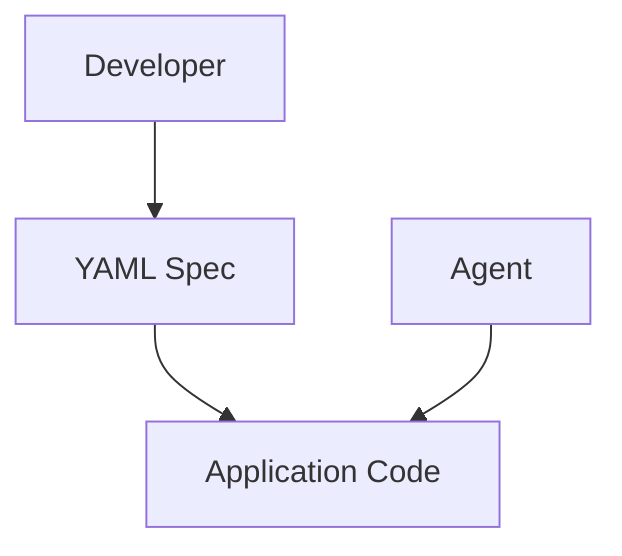

# scripted-yaml

**YAML with a little sugar for formulas, conditions, and scripts.**

Let an agent write 99% of your application. Keep the important 1% under your direct control.



- **Some code is too important to leave buried in generated implementation.** Pricing rules,
  RPG formulas, UI structure, and business processes determine what your application does.
  You need to read, understand, and change them yourself.
- **Keep that code in editable text files.** Reordering a menu should mean moving a YAML item,
  not digging through React components. Changing character progression should mean editing
  a formula, not tracing it through the game engine.
- **Have agents build around those files.** The YAML is part of the application code and
  dictates its behavior—not documentation for an agent to translate into a second implementation.
- **Reserve those files for manual control.** Tell agents to leave them alone while they work
  on rendering, plumbing, and integrations. You own the rules; agents handle the bulk of the implementation.

YAML already gives you readable lists, groups, and multiline text. Scripted YAML keeps that
format and adds enough scripting to express the rules alongside the configuration:

- **Ordinary YAML stays ordinary YAML.** Use it for titles, wording, menu order, and grouping.
- **Add logic where data alone is not enough.** Calculate discounts and character stats,
  show elements conditionally, or repeat business-process steps from input data.
- **Connect scripts through explicit handlers.** The application decides how to execute them;
  formulas use FEEL, and text can include their results.

## Small examples

### A UI definition

- Edit `title` or move a field between groups directly in YAML.
- The UI code renders this structure; it does not own another copy of the layout.

```yaml
title: Edit profile
groups:
  - title: Personal details
    fields: [name, email]
  - title: Preferences
    fields: [language, timezone]
```

### An RPG character

- Change `hp_per_level` to rebalance the character.
- `hit_points!` is a formula: at level 7, this character has 84 hit points.

```yaml
name: Brom
level: 7
hp_per_level: 12
hit_points!: level * hp_per_level
```

### A discount rule

- Change the threshold or formula in one place.
- At a subtotal of 240, the discount is 24 and the message is `You save 24.`

```yaml
$vars:
  subtotal: {}

discount!: if vars.subtotal >= 200 then vars.subtotal * 0.10 else 0
message: You save {{ discount }}.
```

## YAML, with scripting

- No replacement configuration format: these are YAML files, parsed as YAML.
- Formulas and conditions keep dynamic rules in the same file as static values.
- Script markers pass their contents to handlers supplied by your application.
- Validation, optional schemas, and embedded input/output tests help check what you edit.

## Install

```sh
npm install scripted-yaml
```

Node 22+ or Bun. Importing `.ts` files requires Bun or Node 22.18+.

**Load only trusted files:** loading runs `$import` modules and marker handlers.
Validation runs neither and evaluates no formulas.

## Complete examples

Complete files: [`examples/`](examples).

### Shop: discounts and shipping

Change the loyalty rate or free-shipping threshold here; the checkout implementation consumes these rules.

```yaml
$vars:
  cart:     { about: The order. Its subtotal is used here. }
  customer: { about: The buyer. Past orders and tags. }

is_vip!: count(vars.customer.orders) >= 10 or "vip" in vars.customer.tags

discount:
  loyalty!: if is_vip then vars.cart.subtotal * 0.05 else 0
  volume!: if vars.cart.subtotal >= 200 then 15 else 0
  $value!: max(loyalty, volume)
  note: The bigger of the two discounts applies.

to_pay!: vars.cart.subtotal - discount

shipping:
  - name: Standard
    price!: if to_pay >= 50 then 0 else 4.90
  - name: Express
    price: 12.90
    $if!: is_vip

message: You pay {{ to_pay }} and save {{ discount }}.
```

With `cart: { subtotal: 240 }` and a customer tagged `vip`:

```js
{
  is_vip: true,
  discount: { loyalty: 12, volume: 15, $value: 15, note: 'The bigger of the two discounts applies.' },
  to_pay: 225,
  shipping: [{ name: 'Standard', price: 0 }, { name: 'Express', price: 12.9 }],
  message: 'You pay 225 and save 15.',
}
```

Reading `discount` in a formula returns its `$value` (15); the other fields explain the calculation.

### UI: parts that show, hide and change

Rename labels, reorder the sidebar, or change visibility rules without asking an agent to edit components.
The application supplies the renderer and action handlers.

```yaml
$vars:
  user:  { optional: true, about: The signed-in user. Null when signed out. }
  plan:  { default: free }
  flags: { default: [] }

signed_in!: vars.user != null
is_admin!: if signed_in then vars.user.role = "admin" else false
paid!: vars.plan != "free"

header:
  title: Dashboard
  greeting!: if signed_in then "Welcome back, " + vars.user.name else "Welcome"

sidebar:
  - label: Home
    icon: home
  - label: Reports
    icon: chart
    $if!: paid
  - label: Upgrade
    icon: star
    action!js: openCheckout()
    $unless!: paid
  - label: Admin
    icon: shield
    $if!: is_admin
  - $each!: vars.flags
    $as: flag
    label: Beta {{ flag }}
    icon: flask

theme:
  accent: blue
  $when:
    - $if!: paid
      accent: gold
```

Signed out, on the free plan, the result is:

```js
{
  signed_in: false, is_admin: false, paid: false,
  header: { title: 'Dashboard', greeting: 'Welcome' },
  sidebar: [
    { label: 'Home', icon: 'home' },
    { label: 'Upgrade', icon: 'star', action: Script { js: 'openCheckout()' } },
  ],
  theme: { accent: 'blue' },
}
```

For an admin called Ada on the `team` plan with the flag `charts`, the sidebar is Home, Reports,
Admin and "Beta charts", the greeting is "Welcome back, Ada", and the accent is gold.

`action!js` passes `openCheckout()` to your `js` handler; the library does not execute JavaScript itself.

### Game: an RPG character sheet

Tune progression and skill unlocks here; the game engine applies these definitions.

```yaml
$vars:
  hero: { about: "Name, class, level and the seven base attributes." }
  gear: { default: [], about: "Items worn. Each adds an amount to one stat." }

classes:
  knight:   { hp_per_level: 12, sp_per_level: 0, magic: none }
  archer:   { hp_per_level: 8,  sp_per_level: 2, magic: intellect }
  cleric:   { hp_per_level: 7,  sp_per_level: 5, magic: personality }
  sorcerer: { hp_per_level: 5,  sp_per_level: 6, magic: intellect }

# The row of `classes` for this hero: `get value` looks a key up by a name held in a variable.
hero_class!: get value(classes, vars.hero.class)

$functions:
  from_gear(wanted)!: sum(append(vars.gear[stat = wanted].amount, 0))
  bonus(score)!: floor((score - 10) / 3)

# Base value plus what the gear adds.
attributes:
  might!: vars.hero.might + from_gear("might")
  intellect!: vars.hero.intellect + from_gear("intellect")
  personality!: vars.hero.personality + from_gear("personality")
  endurance!: vars.hero.endurance + from_gear("endurance")
  accuracy!: vars.hero.accuracy + from_gear("accuracy")
  speed!: vars.hero.speed + from_gear("speed")
  luck!: vars.hero.luck + from_gear("luck")

casting!: if hero_class.magic = "personality" then attributes.personality else attributes.intellect

stats:
  hit_points!: (hero_class.hp_per_level + bonus(attributes.endurance)) * vars.hero.level
  spell_points!: if hero_class.magic = "none" then 0 else (hero_class.sp_per_level + bonus(casting)) * vars.hero.level
  armor_class!: from_gear("armor") + bonus(attributes.speed)
  to_hit!: vars.hero.level + bonus(attributes.accuracy)
  damage!: max(1, from_gear("damage") + bonus(attributes.might))

resistances:
  fire!: from_gear("fire") + bonus(attributes.luck)
  water!: from_gear("water") + bonus(attributes.luck)
  mind!: from_gear("mind") + bonus(attributes.personality)

rank!: if vars.hero.level >= 10 then "Veteran" else "Novice"
summary: "{{ vars.hero.name }}, {{ rank }} {{ vars.hero.class }} of level {{ vars.hero.level }}"

skills:
  - name: Strike
    damage!: stats.damage
  - name: Shield Wall
    $if!: vars.hero.class = "knight" and vars.hero.level >= 5
  - name: Aimed Shot
    to_hit!: stats.to_hit + 4
    $if!: vars.hero.class = "archer"
  - name: Heal
    restores!: 5 + bonus(attributes.personality) * 2
    cost: 3
    $if!: vars.hero.class = "cleric"
  - name: Fireball
    damage!: bonus(attributes.intellect) * vars.hero.level
    cost: 8
    $if!: vars.hero.class = "sorcerer" and stats.spell_points >= 8
  - name: Lucky Dodge
    $if!: attributes.luck >= 16
```

For Brom, a level 7 knight (might 18, endurance 16, luck 9) with an iron sword (+4 damage), chain
mail (+6 armor) and a ring of might (+3):

```js
{
  hero_class: { hp_per_level: 12, sp_per_level: 0, magic: 'none' },
  attributes: { might: 21, intellect: 8, personality: 10, endurance: 16, accuracy: 13, speed: 11, luck: 9 },
  casting: 8,
  stats: { hit_points: 98, spell_points: 0, armor_class: 6, to_hit: 8, damage: 7 },
  resistances: { fire: -1, water: -1, mind: 0 },
  rank: 'Novice',
  summary: 'Brom, Novice knight of level 7',
  skills: [{ name: 'Strike', damage: 7 }, { name: 'Shield Wall' }],
}
```

Fields resolve on demand: `stats.hit_points` reads `hero_class` and `attributes.endurance`, regardless of file order.

## Multiline text and Markdown

Use `|` for line breaks, `>` for folded text, and `-` to strip the trailing newline.
Both support templates; `!` still marks a formula:

```yaml
$vars:
  subtotal: { default: 0 }

free_shipping_from: 50
shipping!: >-
  if vars.subtotal >= free_shipping_from
  then 0
  else 4.90

message: |-
  ## Delivery

  Standard shipping is free on orders of {{ free_shipping_from }} or more.
  Your shipping charge is {{ shipping }}.
```

The application renders `message` as Markdown. For longer prose, put rules in front matter
and instructions under Markdown headings:

```markdown
---
name: order-review
$vars:
  subtotal: { default: 0 }
stages:
  - id: approval
    $if!: vars.subtotal >= 1000
    instructions!mdq: section("Approval")
---

# Order review

## Approval

Check the delivery address and confirm the payment terms before approving the order.

- Contact the buyer if the address is incomplete.
- Record the approval in the order history.
```

Install `mdq-cli` to extract front matter and select the instruction text:

```ts
import { readFile } from 'node:fs/promises';
import { mdq } from 'mdq-cli';
import { ScriptedYaml } from 'scripted-yaml';

const file = 'order-review.md';
const markdown = mdq(await readFile(file, 'utf8'));
const scripted = new ScriptedYaml({
  markers: { mdq: (selector) => markdown.query(selector).text() },
});
const document = await scripted.loadText(markdown.frontmatter(), { file });
const result = await document.resolve({ vars: { subtotal: 1200 } });
```

The library receives front matter, not the whole Markdown file. The handler returns the selected
section including its heading; `{{ }}` in marker results is not expanded.
The CLI extracts front matter too, but `--markers mdq` does not run this handler.
[Full Markdown example](examples/markdown/web-testing.md).

## The library

```ts
import { ScriptedYaml } from 'scripted-yaml';

class Script {
  constructor(readonly js: string) {}
}

// The only option: one function per marker. `action!js: openCheckout()` calls `js("openCheckout()")`.
const scripted = new ScriptedYaml({
  markers: { js: (source: string) => new Script(source) },
});

const problems = await scripted.validate('ui.yml');       // checks the file; runs nothing
for (const problem of problems) console.log(problem.severity, problem.toString());
// error ui.yml:10  paid!  unknown name "var"; did you mean "vars"?

const document = await scripted.load('ui.yml');           // validates, applies markers; computes nothing
document.data.paid.source;                                // 'vars.plan != "free"'   (a Formula)
document.data.paid.reads;                                 // ["vars.plan"]
document.data.sidebar[2].action;                          // Script { js: "openCheckout()" }

const result = await document.resolve({ vars: { plan: 'team' } });   // all variables in, all values out
result.paid;                                              // true
result.theme.accent;                                      // "gold"
```

| API | Result |
|---|---|
| `validate(path)` | Problems with file, location, key, and severity; no evaluation |
| `load(path)` | Validated document with imports and markers loaded; formulas unevaluated |
| `validateText` / `loadText` | Same operations on YAML text or parsed data; `{ file }` sets the path context |
| `document.resolve({ vars })` | Resolved data; throws `ResolveFailed` on evaluation errors |
| `document.test()` | Results of the file's `$tests` |
| `document.variables` | Declared inputs |

`load` throws `ValidationFailed` with `.problems` on validation errors.

## The command line

```
scripted-yaml validate <file>... [--markers sh,mdq]
scripted-yaml parse <file> [--var NAME=value]... [--vars file.json] [--markers sh,mdq]
```

`validate` reports problems (exit 1 on errors). `parse` outputs JSON; markers become
`{ "marker": "sh", "source": "…" }`. Markdown files are read by their front matter.

```
$ scripted-yaml validate ui.yml --markers js
ok       ui.yml
```

## Reference

- [Specification](SPEC.md): schemas, imports, inheritance, evaluation rules, and embedded tests.
- [Agent skill](skills/scripted-yaml/SKILL.md): authoring and validation instructions.
- [Examples](examples): shops, UI, RPG, routing, pipelines, and Markdown.

## Development

```
bun test            # everything; test/package.test.ts builds dist/ first
bun run typecheck
bun run build       # dist/index.js, dist/cli.js and the type declarations
```

## Syntax reference

| You write | It means |
|---|---|
| `key:` | text or data; `{{ }}` inside text is a formula |
| `key!:` | the value is a formula, written in FEEL |
| `key!name:` | the value is handed to the application's function `name` |
| `$keyword:` | inputs, conditions, repetition, schemas, imports, and embedded tests |

Formulas use FEEL, not JavaScript. [Expression examples](docs/examples) · [Full syntax](SPEC.md).

Licence: MIT.
